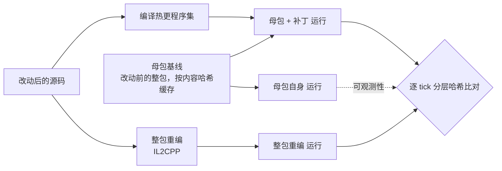

# patchparity

**Unity 热更补丁等价性验证。** 给定一处代码改动，回答：把它做成 HybridCLR 热更补丁装到线上的母包上运行，行为是否与用改动后的
源码整包重编（IL2CPP）一致；不一致时，从第几个 tick 起、哪个组件先分歧。

全流程可以由 AI Agent 经 MCP 工具无人值守驱动，判定由代码从证据得出，不采信 Agent 的说法。

命令行验证一处危险改动的输出（云主机实测，节选）：

```
用例 search-danger-curve｜场景 seed42-t600-p2-b0-37d55797｜预期 危险
母包基线: 命中缓存，跳过构建
  baseline-run         成功      4.0 秒
  patch-compile        成功     16.0 秒
  patch-run            成功      4.0 秒
  patch-run-repeat     成功      4.0 秒
  rebuild-run          成功      4.0 秒

确定性自检: 通过（同场景两次运行逐 tick 一致）
覆盖自检: 通过 末帧组件实例数=32
可观测性: 改动在此场景下可观测（整包重编与母包自身逐帧不同）

判定: 不等价，首个分歧 tick=2
  frame  整包重编=1896450873354984362  打补丁=13174895344143919377
  c:TransformComponent:hash  整包重编=15209523222199701566  打补丁=2256429061210445750
  c:PhysicsBodyComponent:hash  整包重编=16721210803622162489  打补丁=15134311212692200980

与预期相符
```

上面这处改动只改了框架里击退衰减曲线的一个系数。补丁编得出、装得上、跑得完，两项自检都通过，行为却从第 2 帧起就不同：
这段代码在母包里，热更补丁根本带不过去。而在默认场景下（角色不移动、没有地面、从不发生击退），同一个改动会被判为"等价"。

## 为什么需要它

热更补丁"能装能跑"不等于"行为正确"。实测中遇到过三类隐蔽的事故，都不会报错：

1. **补丁装得上、跑得完，行为却不同**：改动有一部分落在母包里（AOT 程序集），补丁只带走了另一部分。
2. **"一致"是空的**：验证场景根本没执行到改动，两边当然一致。没有覆盖证据的"一致"不构成证据。
3. **整包都编不过，补丁却照样装得上**：例如母包程序集反向引用了热更程序集。补丁一路悄悄丢掉了母包那部分改动。

patchparity 对每处改动都跑两条路，逐帧比对模拟状态，并给出覆盖证据。

## 原理



- **被测样例**：[xpTURN/Klotho](https://github.com/xpTURN/Klotho) 的 Brawler，一个确定性的 ECS 对战游戏（定点数、固定步长），锁定在
  `e29c489`。注入的无头验证载体（`injected/`）在给定场景下跑若干 tick，每个 tick 对整帧与每种组件类型分别记哈希（23 种组件）。
- **两条路**：打补丁 = 母包基线 + 新编译的热更程序集；整包重编 = 用改动后的源码重新构建整包，作为标准答案。
- **比对**：逐 tick 比较分层哈希，报首个分歧 tick 与分歧的组件层。
- **三项自检**，任一不过即判作废，不报"一致"：
  - 确定性：同一补丁同一场景跑两次，必须逐 tick 一致；
  - 覆盖：末帧世界非空，改动触及的组件在运行中出现过；
  - 可观测性：同一场景下整包重编与母包自身必须逐帧不同，即改动确实被执行到了。场景搜索类题目硬性要求，其余只报告。
- **判定**：等价、不等价、补丁失败（编译/加载/运行期）、整包重编失败、作废、证据不全。
- **成本**：母包基线按内容哈希缓存（源码、本地包、包清单、编辑器版本），只建一次；整包重编是每个改动各自的标准答案，必须现建，
  同一改动重跑时也按内容命中缓存。冷启动一次完整验证约 20 分钟（母包基线 10.5 分钟、整包重编 8 分钟），缓存命中时约 1 分钟。

## Agent 驱动

MCP 服务端（`src/PatchParity.Mcp`）提供 7 个工具：`list_scenarios`、`build_package`、`build_patch`、`revert_patch`、`run_scenario`、
`wait_job`、`compare_runs`。启动 Unity 的工具是异步任务，由 `wait_job` 分次等待。

- 服务端只记事实、不下结论：每完成一步就写进台账 `patchparity-ledger.json`；
  `patchparity judge` 用与命令行同一套规则从台账判定。Agent 说什么都不影响判分。
- 会话隔离：同一时刻只允许一个会话改动被测工程（工作区租约），施加改动前先记日志，服务端被强杀后，下一个会话开工前按日志恢复源码。
- 用 [Pigeon](https://github.com/yanami4k/pigeon)（同一作者的 Agent 编排与评测工具）的 `pigeon eval` 跑题，
  模型为 DeepSeek `deepseek-v4-flash`。

## 结果

所有题目都先用命令行逐题实测得出标准答案（不经 Agent），再由 Agent 驱动跑完，judge 与标准答案比对。

| 题集 | 题数 | Agent 驱动的结果 | 报告 |
|---|---|---|---|
| 安全 / 危险 / 边界 | 13（4 / 3 / 6） | 13/13 判对（首轮 12/13，judge 的一处序列化缺陷修复后重跑通过） | [S5 报告](eval/results/2026-10-12-s5.md) |
| 场景搜索 | 5（安全 3 / 危险 2） | 最终一轮 5/5，每题第一次尝试即构造出可观测的场景 | [场景搜索报告](eval/results/2026-10-12-s6-search.md) |

- 13 道题的整轮 116 分钟、模型花费 0.0215 美元；场景搜索最终一轮 4.4 分钟、0.0093 美元。
- 两条路其实都解释执行玩法代码，差别只在母包一侧：只改玩法代码的"冒险写法"（换字段顺序、新增 BCL 依赖、浮点转整数……）实测全部等价；
  造成不一致的都是触及母包的改动。
- 场景搜索的两道危险题在默认场景下被判为"等价"（假阴性），可观测性检验把它们识别为"不可观测"；换到 Agent 构造的场景，都判为不等价。
- 评测本身的缺陷同样要查：场景搜索第一轮 5/5 不作数，工具说明里的示例恰好就是答案。经过见场景搜索报告。

逐题的改动、预期与实测依据：[`cases/用例与实测结论.md`](cases/用例与实测结论.md)。

## 仓库结构

| 路径 | 内容 |
|---|---|
| `src/PatchParity.Pipeline` | 核心库：场景、缓存键与母包基线缓存、驱动 Unity、分层哈希比对、自检与判定、台账 |
| `src/PatchParity.Cli` | 命令行：`verify` 完整验证一处改动，`judge` 从台账判定 |
| `src/PatchParity.Mcp` | MCP 服务端（stdio），7 个工具 |
| `tests/` | xUnit 测试 223 条（核心库 147、MCP 64、命令行 12），关键修复都做过变异验证 |
| `injected/` | 注入被测样例的代码：无头验证载体、HybridCLR 构建与补丁编译的编辑器脚本、环境补丁 |
| `cases/` | 改动用例（unified diff）与 `cases.json`（类别、预期、触及组件、场景搜索参数） |
| `eval/` | 由 `cases.json` 生成 Pigeon 题目、命令行逐题实测脚本、报告 |
| `setup/` | 在一台全新 Windows 主机上搭好全部环境的脚本与手册 |

## 复现

只跑测试（不需要 Unity）：

```powershell
dotnet test tests/PatchParity.Pipeline.Tests
dotnet test tests/PatchParity.Mcp.Tests
dotnet test tests/PatchParity.Cli.Tests
```

完整验证需要 Windows、Unity 6000.3.18f1（含 IL2CPP 模块）与 MSVC。[`setup/README.md`](setup/README.md) 从开云主机写起，
脚本会装好工具链、按锁定提交取被测样例并打环境补丁、发布 patchparity、取 Pigeon；首次约两到三小时，大部分时间在下载与 Unity 首次导入。
之后一次完整验证：

```powershell
patchparity verify --unity <Unity.exe> --project <Klotho>\Samples\Brawler --repo <Klotho> `
  --artifacts <产物目录> --cache <缓存目录> `
  --case cases\safe-item-lifetime.patch --name safe-item-lifetime --touched ItemComponent --expect safe
```

开发与实测用的是阿里云香港的按量付费 Windows 主机（8 vCPU、32 GiB）：15 GB 内存的机器跑单个 IL2CPP 构建就接近吃满。

## 已知限制

- 只在 Windows 桌面平台验证过，没有在移动端真机上跑过；热更方案只做了 HybridCLR。
- 只有一个被测样例，锁定在上游的一个提交，不跟随上游更新。
- "等价"只对所跑的场景成立。可观测说明改动被执行到了，不说明所有分支都覆盖到了。
- 场景参数集是固定的（地面、移动速度、职业、出生位置、按键频率、追逐）。现有场景搜索题偏容易：题面交代了默认场景缺什么。
  需要多步前置条件（特定职业的技能、道具拾取、对局结算）的改动还没有出题。
- 同一时刻只验证一处改动（并发 1）：多个改动并行要多份被测工程，内存也不够。
- 母包基线缓存键里的"工程设置"一项只统计了 `.cs` 与 `.asmdef`，脚本宏与脚本后端的变化不会让缓存失效。
- 补丁编译失败时，Unity 已经退出，工具仍要等到 5 分钟超时才判失败。

## 依赖

[Unity](https://unity.com/) 6000.3.18f1 · [HybridCLR](https://github.com/focus-creative-games/hybridclr) v8.14.1 ·
[Klotho](https://github.com/xpTURN/Klotho)（被测样例）· .NET 8 · [Pigeon](https://github.com/yanami4k/pigeon)（Agent 编排与评测）
