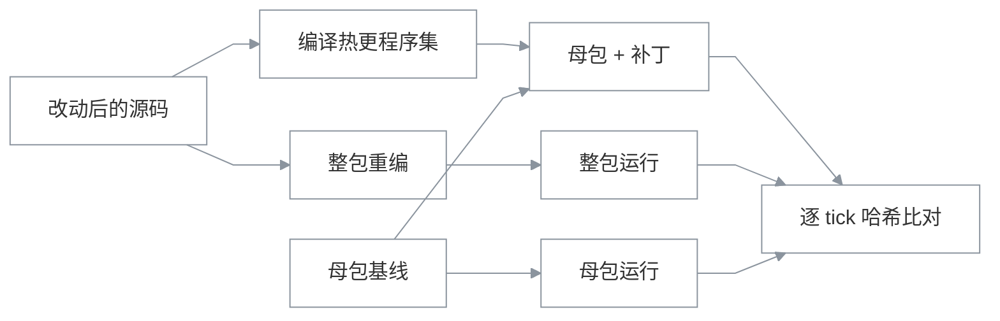

# patchparity

Unity HybridCLR 热更补丁的行为验证工具。当前只覆盖 Windows、HybridCLR，以及一个锁定提交的 Klotho 样例，适用范围见文末。

给定一处源码改动，工具会跑两条路径：

1. 把改动编译成热更程序集，装到改动前的母包上运行；
2. 用改动后的源码完整重编 IL2CPP 包，作为对照。

两条路径使用同一个固定场景。验证载体每个 tick 对整帧和每类组件分别记哈希，比对后输出第一个分歧的 tick 和组件类型。

## 为什么需要它

补丁能编译、能加载、能跑完，不代表行为和整包一致。

比较常见的情况是改动有一部分落在 AOT 母包里，补丁只带走了另一部分。补丁看起来一切正常，运行结果却和整包不同。还有一种更容易误判的情况：默认场景根本没有执行到改动，两边都没跑到这段代码，于是被判成“等价”。

例如击退衰减曲线的一个系数改动。默认场景里角色不移动、场地没有地面，也不会发生击退；把补丁和整包放在这个场景里比较，结果一致。换到能触发击退的场景后，从第 2 个 tick 开始出现差异。前一个“一致”没有说明任何问题，只说明改动没有被执行。

## 做法



被测样例是 [xpTURN/Klotho](https://github.com/xpTURN/Klotho) 的 Brawler，锁定在 `e29c489`。这是定点数、固定步长的 ECS 对战游戏。注入的无头验证载体在 `injected/`，每个 tick 记录整帧哈希和 23 类组件各自的哈希。

为避免把“没跑到”当成“没问题”，每次验证还会做三项检查：

- 确定性：同一个补丁、同一个场景跑两次，逐 tick 结果必须一致；
- 覆盖：末帧世界不能为空，改动涉及的组件要在运行中出现过；
- 可观测性：同一场景下，整包运行必须和未打补丁的母包不同，说明改动确实执行到了。场景搜索题强制要求这一项，其余题只记录结果。

确定性和覆盖任意一项不通过，这次验证记为“作废”，不会给出“等价”。可观测性在场景搜索题里是硬性要求，不通过即作废；其余题只记录，不参与判定。

判定分为：等价、不等价、补丁失败（编译、加载或运行期）、整包重编失败、作废、证据不全。

## 成本

母包基线按内容哈希缓存，源码、本地包、包清单和编辑器版本参与计算，只需要构建一次。整包重编是每处改动的对照，必须现建；同一处改动重跑时可以命中缓存。

冷启动完整验证一次约 20 分钟，其中母包基线约 10.5 分钟，整包重编约 8 分钟。缓存命中后约 1 分钟。

## Agent 接入

`src/PatchParity.Mcp` 是一个 stdio MCP server，提供 7 个工具：`list_scenarios`、`build_package`、`build_patch`、`revert_patch`、`run_scenario`、`wait_job`、`compare_runs`。启动 Unity 的操作是异步任务，需要由 `wait_job` 分次等待。

服务端只记录执行事实。每完成一步就写入 `patchparity-ledger.json`，`patchparity judge` 从台账按固定规则判定。judge 不读取 Agent 的总结，所以 Agent 在最终回答里写什么，不影响判分。

同一时间只允许一个会话修改被测工程。工具在施加改动前先写日志，并持有工作区租约；服务端被强杀后，下一个会话会按日志恢复源码。

跑题使用 [Pigeon](https://github.com/yanami4k/pigeon-harness) 的 `pigeon eval`，锁定在 `65ff318`。这个版本之后移除了该跑题器，换新版需要另写入口；判分仍在 patchparity 一侧。

## 结果

每道题先用命令行实测，得到标准答案，再由 Agent 经 MCP 跑一遍，最后用 judge 的判定和标准答案比对。

| 题集 | 题数 | Agent 结果 | 报告 |
|---|---|---|---|
| 安全 / 危险 / 边界 | 13（4 / 3 / 6） | 13/13 判对。首轮 12/13，原因是 judge 输出摘要时序列化崩溃；修复后重跑通过 | [S5 报告](eval/results/2026-10-12-s5.md) |
| 场景搜索 | 5（安全 3 / 危险 2） | 最终一轮 5/5，每道题第一次尝试就构造出了可观测场景 | [场景搜索报告](eval/results/2026-10-12-s6-search.md) |

13 道题合计 116 分钟，模型费用 0.0215 美元；场景搜索最终一轮 4.4 分钟，费用 0.0093 美元。

几道题跑下来得到的结论：

- 两条路径都解释执行玩法代码，差别只在母包一侧。只改玩法代码的写法，包括调整字段顺序、新增 BCL 依赖、浮点转整数，实测都等价；真正出问题的是改到母包里的改动。
- 场景搜索里的两道危险题，在默认场景下都被判成“等价”，可观测性检查把它们标成“不可观测”。换到 Agent 构造的场景后，两道题都判为不等价。
- 评测本身也会出错。场景搜索第一轮也报过 5/5，但工具说明里的示例恰好就是答案，那一轮不能算。经过写在场景搜索报告里。

逐题的改动、预期和实测记录在 [`cases/用例与实测结论.md`](cases/用例与实测结论.md)。

## 目录

| 路径 | 内容 |
|---|---|
| `src/PatchParity.Pipeline` | 场景、缓存键、母包基线缓存、Unity 调用、逐 tick 哈希、自检、判定、台账 |
| `src/PatchParity.Cli` | `verify` 验证一处改动，`judge` 从台账判定 |
| `src/PatchParity.Mcp` | stdio MCP server |
| `tests/` | xUnit 测试，覆盖核心库、MCP 和 CLI；关键修复做过变异验证 |
| `injected/` | 无头验证载体、HybridCLR 构建与补丁编译脚本、被测工程的环境补丁 |
| `cases/` | 改动 diff、类别、预期、触及组件和场景参数 |
| `eval/` | 由 `cases.json` 生成题目、命令行实测脚本和评测报告 |
| `setup/` | 在全新 Windows 主机上安装工具链、准备被测工程的脚本和说明 |

## 运行

不需要 Unity，只跑测试：

```powershell
dotnet test tests/PatchParity.Pipeline.Tests
dotnet test tests/PatchParity.Mcp.Tests
dotnet test tests/PatchParity.Cli.Tests
```

完整验证需要 Windows、Unity 6000.3.18f1（含 IL2CPP 模块）、MSVC 和 .NET 8。全新机器从 [`setup/README.md`](setup/README.md) 开始，脚本会安装工具链、拉取锁定提交的 Klotho、打环境补丁、发布 patchparity，并准备 Pigeon。首次安装大部分时间花在下载和 Unity 第一次导入上。

准备完成后，验证一处改动：

```powershell
patchparity verify --unity <Unity.exe> --project <Klotho>\Samples\Brawler --repo <Klotho> `
  --artifacts <产物目录> --cache <缓存目录> `
  --case cases\safe-item-lifetime.patch --name safe-item-lifetime --touched ItemComponent --expect safe
```

开发时使用的是一台 8 vCPU、32 GiB 内存的 Windows 云主机。单个 IL2CPP 构建在 15 GiB 内存的机器上就接近吃满。

## 限制

- 只在 Windows 桌面平台验证过，没有在移动端真机跑过；热更方案只做了 HybridCLR。
- 只有一个被测样例，锁定在上游的一个提交，不跟随上游更新。
- “等价”只对实际跑过的场景成立。可观测性只能说明改动被执行到了，不能说明所有分支都被覆盖。
- 场景参数是固定的：地面、移动速度、职业、出生位置、按键频率、追逐。现有场景搜索题偏容易，题面已经提示默认场景缺什么。需要多步前置条件的改动还没有出题。
- 同一时间只能验证一处改动。并行要多份被测工程，内存不够。
- 母包基线缓存键里的“工程设置”只统计 `.cs` 和 `.asmdef`，脚本宏或脚本后端变化不会让缓存失效。
- 补丁编译失败时 Unity 已经退出，工具仍要等到 5 分钟超时才判失败。

## 依赖

[Unity](https://unity.com/) 6000.3.18f1 · [HybridCLR](https://github.com/focus-creative-games/hybridclr) v8.14.1 ·
[Klotho](https://github.com/xpTURN/Klotho) `e29c489` · .NET 8 · [Pigeon](https://github.com/yanami4k/pigeon-harness) `65ff318`
